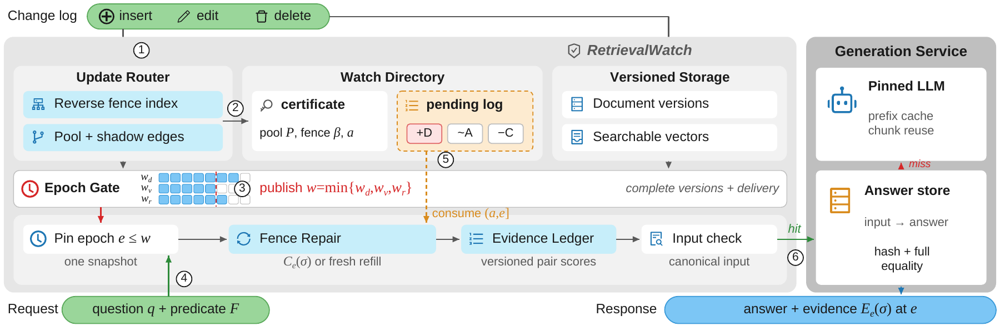
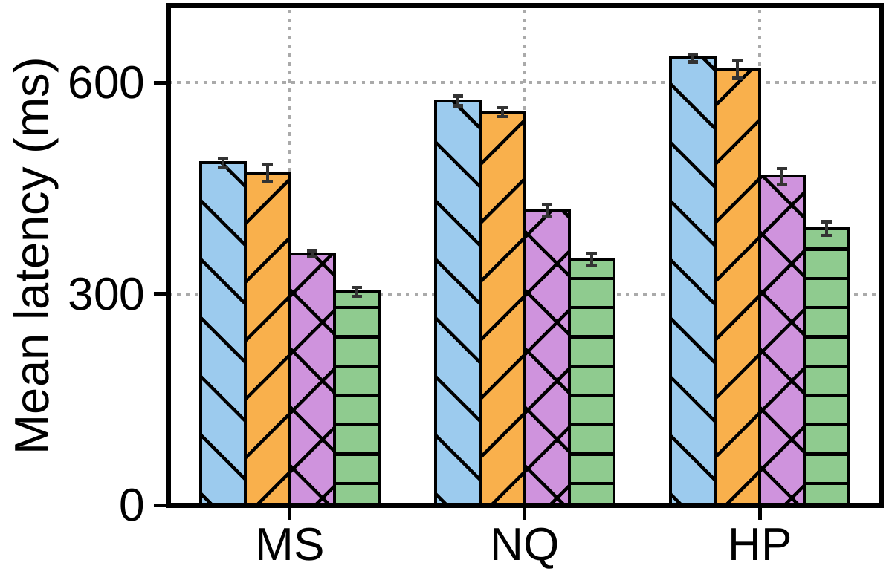
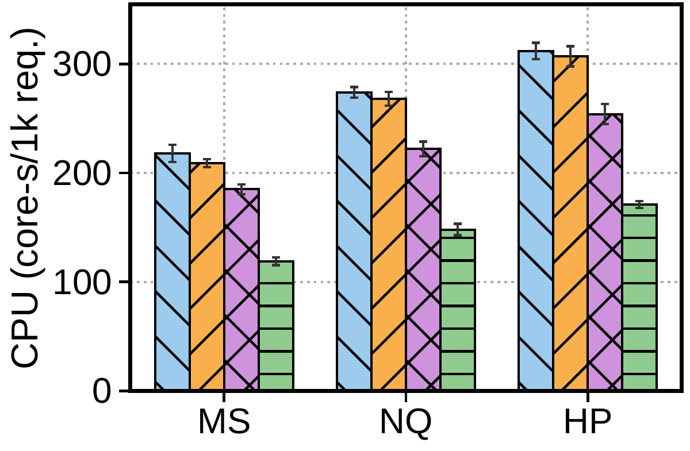

# RetrievalWatch: Retrieval-Consistent RAG Caching over Mutable Data

This repository contains the source code for the paper:

> RetrievalWatch: Retrieval-Consistent RAG Caching over Mutable Data.

## Overview

RetrievalWatch maintains exact two-stage retrieval results as documents change. Candidate pools retain guards, and exclusion fences bound omitted documents. A reverse sphere-tree index routes new arrivals, while positive and pending identifier dependencies capture deletions and score decreases. Deferred repair coalesces intermediate changes before reranking. Versioned pair scores and complete canonical generation inputs control answer reuse.



*RetrievalWatch system architecture.*

Implemented components include exact candidate selection, guard promotion and refill, geometric update routing, pending shadow dependencies, contiguous document/vector/routing epoch gates, historical snapshot reads, deterministic reranking ties, evidence-aware answer caching, metadata predicates, and an explicit cost-admission function.

**Implementation scope:** the engine runs sequentially in memory. A global lock closes registration and fence-replacement races, and full corpus snapshots provide historical reads. Distributed bootstrap handoff, crash recovery/WAL, bounded retention, automatic online cost estimation, GPU batching, ANN integration, and KV caching are outside this release.

## Evaluation Results

The following panels compare end-to-end latency and combined CPU across three workloads. Reproducing these performance measurements requires the full experimental setup; the included tests check functional correctness.

<p align="center">
  
</p>

| End-to-end latency | Combined request and update CPU |
| --- | --- |
|  |  |

*Latency and combined CPU across workloads. MS, NQ, and HP denote MS MARCO, Natural Questions, and HotpotQA, respectively; RW denotes RetrievalWatch.*

---

## Requirements

- Python >= 3.10
- Standard library only for the reference engine and tests
- External embedding, deterministic reranker, and generator implementations for real model execution

Examples run on CPU and use deterministic fixtures. The engine normalizes embeddings and rejects incompatible dimensions.

---

## Usage

### 1. Installation

```bash
git clone https://github.com/QSI432/RetrievalWatch.git
cd RetrievalWatch
python -m venv .venv
# Activate .venv for your shell, then:
python -m pip install -e .
```

### 2. Replay the Example

```bash
python -m retrievalwatch examples/updates.jsonl
```

The fixture uses text-overlap scoring and concatenation instead of real reranking and generation. Each request prints its pinned epoch, ordered candidate identities/versions, ordered evidence, and answer. The last request demonstrates a historical snapshot.

### 3. Integrate Model Backends

```python
from retrievalwatch import Document, Query, RetrievalWatch

def rerank(query, document):
    # Replace with a fixed deterministic pairwise model.
    return float(query.text.lower() in document.text.lower())

def generate(query, evidence):
    # Replace with your generation backend using exactly this ordered evidence.
    return "\n".join(document.text for document in evidence)

service = RetrievalWatch(rerank, generate)
epoch = service.commit({1: Document(1, 1, (1, 0), "Example evidence",
                                    {"collection": "docs"})})
query = Query("example", (1, 0), L=10, k=3, guards=4,
              filters={"collection": {"eq": "docs"}},
              reranker="your-fixed-reranker-revision",
              generator="your-generator-revision")
service.register(query)
response = service.request(query)
service.commit({1: Document(1, 2, (1, 0), "Updated evidence",
                              {"collection": "docs"})})
updated = service.request(query)
original = service.request(query, epoch=epoch)
```

Query signatures include query text/vector, predicates, depths, guards, and model/prompt revisions. Any change to those policies creates a new signature. Document versions must increase across edits and reinsertions. Filters support equality, set membership, and inclusive ranges; missing fields fail the predicate. `request(..., maintained=False)` runs the same exact fresh retrieval contract for comparison. Model callbacks must be fixed and must not re-enter the service to mutate its state.

### 4. Exercise the Epoch Gate and Admission Rule

`stage(epoch, changes)` accepts contiguous epochs. Call `complete(epoch, stage)` separately for `documents`, `vectors`, and `routing`. Publication cannot bridge a missing earlier marker. Ordinary `commit(changes)` completes all three synchronously. `should_admit(...)` implements an estimated CPU-cost admission rule; callers supply rates and costs and explicitly register or evict watches. It is not an automatic cost profiler.

### 5. Run Correctness Validation

```bash
python -m unittest discover -s tests -v
```

Tests compare maintained candidates, evidence, and answers with exhaustive fresh execution under randomized insertions, edits, deletions, filters, and delayed repairs. Focused tests cover shadow deletion, historical reads, publication gaps, tie-breaking, version changes, answer reuse, and reverse-index completeness. [Release validation](docs/VALIDATION.md) records the executed checks. See [implementation notes](docs/IMPLEMENTATION.md) for the exact scope.

---

## Reference

- [Python dataclasses](https://docs.python.org/3/library/dataclasses.html)
- [Python threading](https://docs.python.org/3/library/threading.html)

